# Tutor Compass

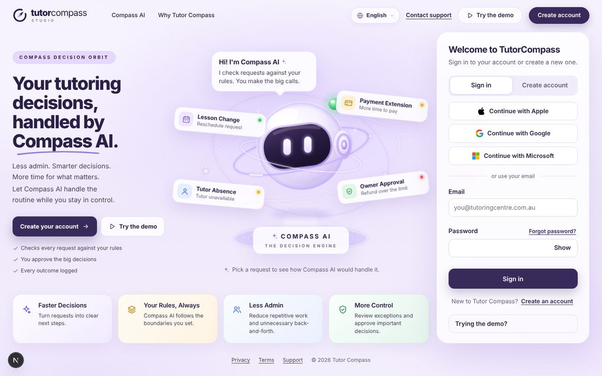

## For Judges

| | |
| --- | --- |
| **Live app** | https://tutorcompass.app |
| **Code** | https://github.com/AliRauf111/INFS3605 |
| **Owner login** | Email: `owner@tutorcompass.example` · Password: `dohnar-rargUq-8cabjo` |
| **How we used AI** | [PROMPTS.md](PROMPTS.md) |

Everything in the app is fictional demo data. **The demo resets every time you refresh the page**, so you can't break anything, and **nothing is ever really sent, paid or refunded**. Messages are marked Simulated.

### A 3-Step Tour As The Business Owner (About 5 Minutes)

1. **See what needs you.** Sign in, then click the Compass robot in the bottom right corner and choose **What Needs My Attention?** Compass lists everything waiting for the owner, grouped into Red, Amber and Green, with exact counts and a button to open each item.
2. **Make a decision.** Open **Approval Alley** in the sidebar. Open the $75 refund for family FAM-07 (amber, because refunds from $50 to $200 need the owner). Click **Start Review**, choose **Approve**, type a short reason and confirm. The reason is saved in the request's history and the rules stay the same.
3. **Let the agents do the admin.**
   - Go to **Payments > Autonomous Recovery** and click **Complete Entire Scan**. Click **Review Families**, then **Prepare Messages**, then move to **Owner Approval**. Tick the box and click **Simulate Send (Demo Mode)** to approve the whole batch of reminders at once.
   - Go to **Insights** and scroll to the **Student Retention Agent**. It flags students who may be about to leave and explains why. Click **Prepare Check-ins**, then approve a draft on the **Draft and Approve** tab.
   - Finish on **Weekly Briefing** in the sidebar: a one-page summary of the week, what needs the owner and what Compass suggests next.

## What It Is

Tutor Compass helps the owner and admin team of a small tutoring business handle everyday requests (a refund, a lesson change or more time to pay) without the owner losing control. Staff check each request against the owner's rules and get a result from a fixed rule engine: **green** (go ahead), **amber** (check or get approval) or **red** (owner decides). Amber and red requests go to the owner, who approves, declines or asks for more information. Every step is saved with the rule version and the records it relied on.

This is a university prototype for INFS3605. **All people, bookings and payments are fictional.** The app never pays, refunds, sends messages or changes real bookings. It records decisions and prepares drafts for a person to approve.

## What You Can Do In It

- **Requests and the rule engine.** Log a request through a guided wizard or by pasting a parent's message. The rule engine (not the AI) decides the colour.
- **Approval Alley.** The owner's queue. Approve, decline or ask for more information, always with a reason. New staff accounts are also approved here.
- **Compass AI.** An assistant on every page. It gives a Red, Amber and Green briefing, runs workflows for lesson changes, payment extensions and tutor absences, and prepares decision-ready reviews. You can type or speak to it. Every saved change needs a person to confirm a preview first.
- **Payments recovery agent.** Scans overdue invoices, groups them by the family who pays, drafts personalised email and SMS reminders and waits for one owner approval for the whole batch.
- **Student Retention Agent** (on Insights). Spots students who may be about to leave (falling attendance, cancellations, concerns), explains the evidence and drafts a check-in message for the owner to approve.
- **Weekly Owner Briefing.** A one-page weekly summary of money, parent messages, lessons, what Compass did and what it recommends next. It can also be emailed to the owner on a schedule (simulated in the demo).
- **Schedule.** A month calendar of every lesson, with shortcuts to change a lesson.
- **Knowledge Hub, Rules and Coverage.** The owner's rules, procedures, bookings and payments in one place, plus suggestions for gaps in the rules.
- **14 languages.** English, Simplified Chinese, Cantonese (Traditional), Arabic (right to left), Vietnamese, Punjabi, Greek, Italian, Hindi, Spanish, Tamil, Telugu, Marathi and Bengali. Pick one from the globe menu.
- **Display and Accessibility panel.** Text size from 100% to 200%, Focus View, Reduce Motion, Larger Controls and a light, dark or high contrast theme.
- **Compass Decision Orbit landing page.** The sign-in page shows how a request moves through Compass before anyone logs in.

## Screenshots

| | |
| --- | --- |
| 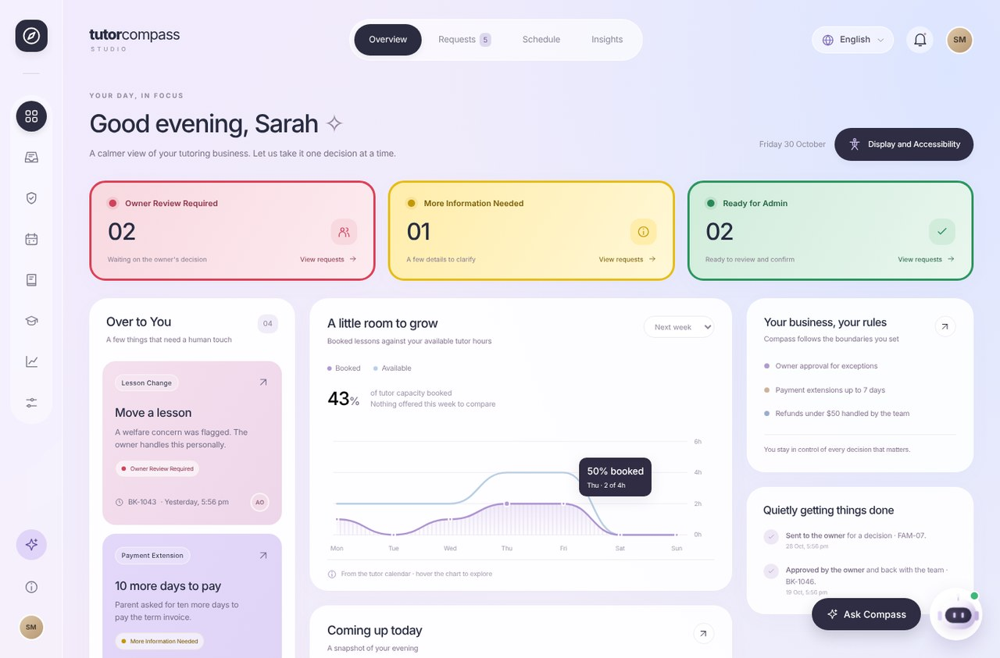 **Overview.** Red, amber and green counts and today's work. | 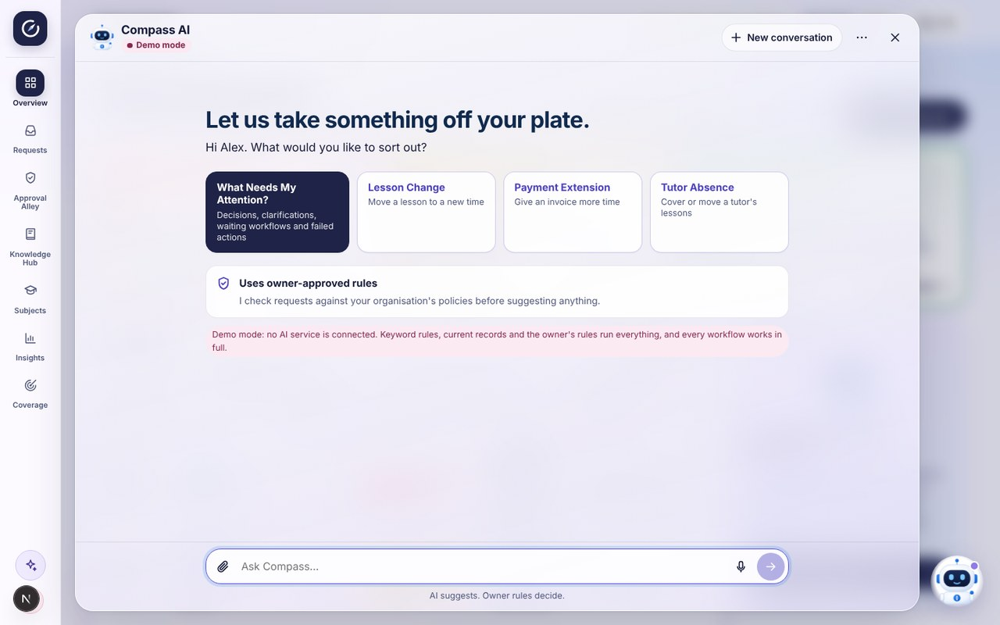 **Compass AI.** The four shortcuts, starting with What Needs My Attention? |
| 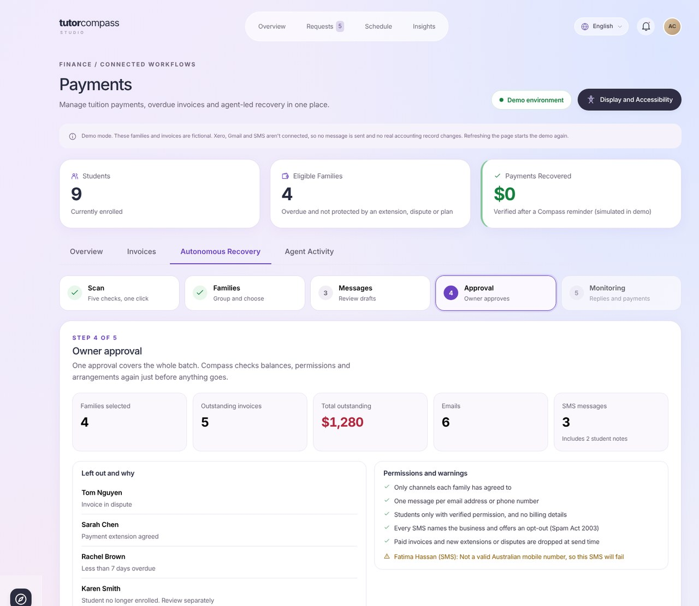 **Payments.** One owner approval for the whole batch of reminders. | 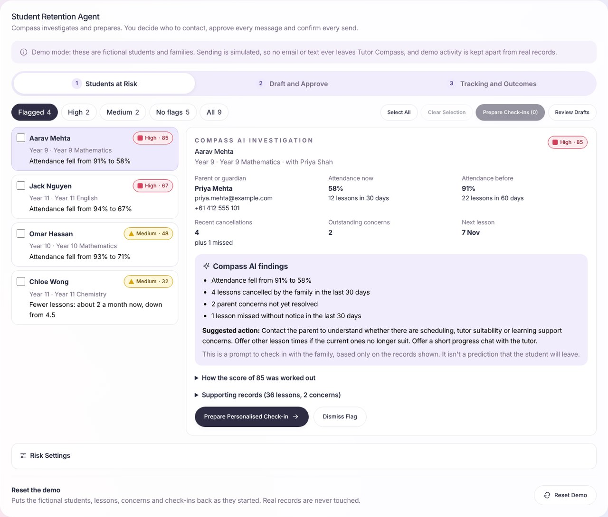 **Student Retention Agent.** Students at risk, with the evidence. |
| 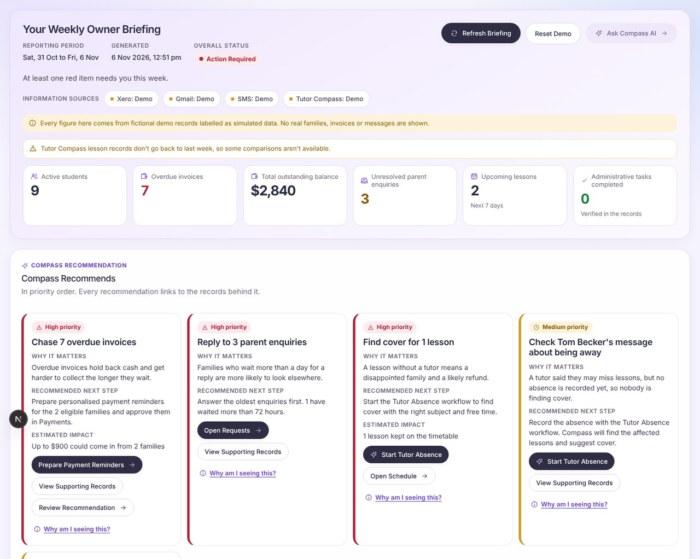 **Weekly Owner Briefing.** The week at a glance and what to do next. | 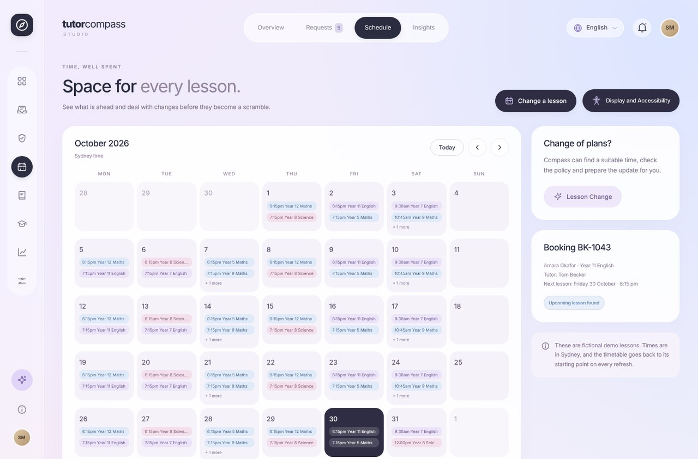 **Schedule.** Every lesson in a month view. |
| 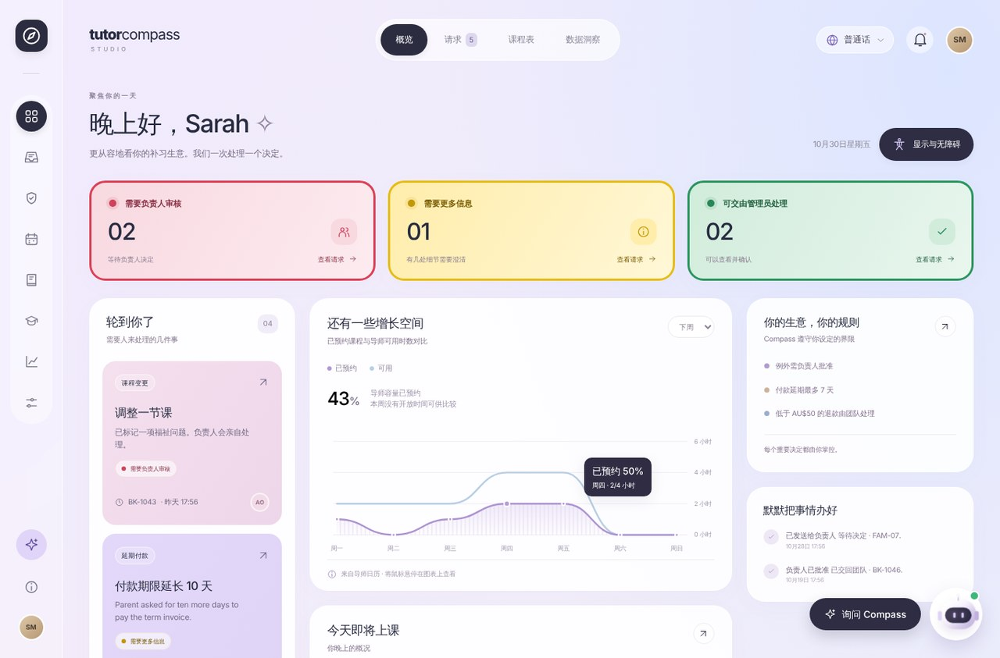 **Simplified Chinese.** One of 14 languages. | 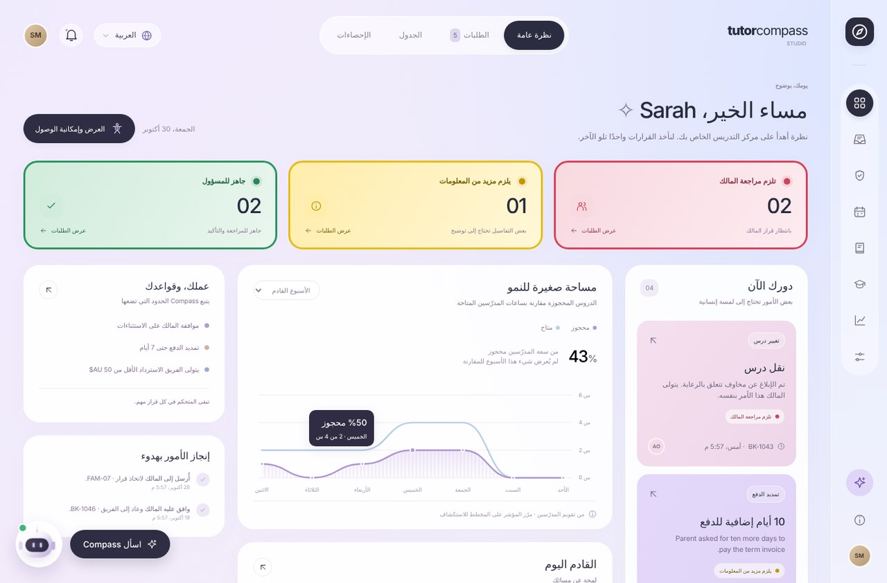 **Arabic.** The whole layout flips for right-to-left reading. |
| 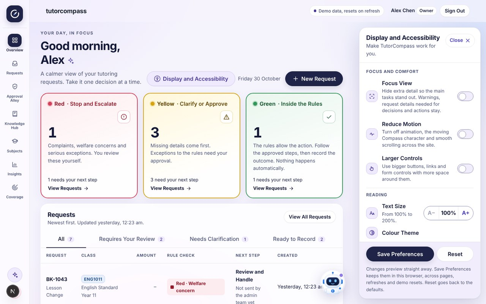 **Display and Accessibility.** Text size, Focus View, Reduce Motion and themes. |  **Landing page.** The Compass Decision Orbit. |

**On a phone.** The landing page and the overview.

<p>
  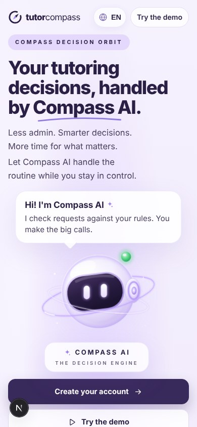
  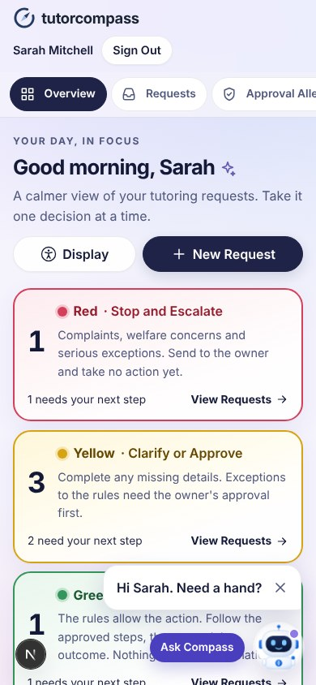
</p>

## More Detail

- What it does and why: [SPEC.md](SPEC.md)
- How AI tools were used to build it: [PROMPTS.md](PROMPTS.md)
- The earlier Flask prototype is kept in [prototypes/flask-traffic-lights](prototypes/flask-traffic-lights)

## How It Fits Together

```
Browser  ──>  Next.js server (pages, API routes, rule engine, AI calls)  ──>  Supabase (Postgres + Auth)
                                    │
                                    └──>  Anthropic API (optional, server only)
```

The browser never talks to Supabase or Anthropic. All keys stay on the server.

| Concern | Where |
| --- | --- |
| Screens | `src/app/**/page.tsx`, `src/components` |
| API routes (every one checks the session and role) | `src/app/api` |
| Rule engine (pure, deterministic, unit tested) | `src/lib/engine` |
| Fact validation shared by the wizard and AI intake | `src/lib/validation/facts.ts` |
| Record lookup (bookings, payments, availability, policy) | `src/lib/context` |
| AI extraction, drafting and rule proposals | `src/lib/ai`, `src/lib/actions/drafts.ts`, `src/lib/actions/policies.ts` |
| Sign-in and roles | `src/lib/auth`, `src/proxy.ts` |
| Actions that change data | `src/lib/actions` and database functions in `supabase/migrations` |
| Activity panel events | `src/lib/agent` |

## Run It Locally

You need Node 22 and a Supabase project (hosted, or local through the Supabase CLI and Docker).

1. Install packages: `npm ci`
2. Copy `.env.example` to `.env.local` and fill it in:
   - `SUPABASE_URL`: Project Settings > Data API in the Supabase dashboard
   - `SUPABASE_SECRET_KEY`: Project Settings > API Keys > Secret keys (starts with `sb_secret_`)
   - `DEMO_ADMIN_PASSWORD` and `DEMO_OWNER_PASSWORD`: choose two new passwords of 10+ characters
   - `ANTHROPIC_API_KEY`: optional. Without it the AI features run in a clearly labelled simulated mode.
3. Create the tables and fictional data. Either:
   - **Supabase dashboard, one paste**: create the two demo users first (Authentication > Users > Add user, tick Auto confirm), then paste all of `supabase/setup-everything.sql` into SQL Editor and click Run. It contains every migration, the seed data and the role assignments. Regenerate it with `npm run sql:bundle` after changing a migration or seed file.
   - **Supabase dashboard, file by file**: open SQL Editor and run these files in order: `supabase/migrations/20261015000001_requests.sql`, `..._workflow_schema.sql`, `..._workflow_functions.sql`, then `supabase/seed.sql`. Optionally run `supabase/demo-history.sql` for extra past cases on the coverage screen.
   - **Supabase CLI**: `npx supabase init` (first time only, if there is no `supabase/config.toml`), `npx supabase link --project-ref <your-ref>`, then `npx supabase db push --include-seed`.
4. Create the two demo accounts: `npm run seed:users`
5. Start the app: `npm run dev` and open http://localhost:3000
6. Sign in with the demo owner or admin account and the passwords you chose.

`.env.local` is ignored by Git. Never commit it, and never rename the variables with a `NEXT_PUBLIC_` prefix, because that would copy them into browser code.

### In GitHub Codespaces

The repo has a dev container with Node 22 and Docker. Open a Codespace, then either follow the steps above with a hosted project, or run a local Supabase:

```
npx supabase init          # first time only
npx supabase start         # prints the local API URL and secret key
npx supabase db reset      # applies migrations and seed.sql
```

Put the printed API URL and secret (service role) key into `.env.local`, then run `npm run seed:users` and `npm run dev`.

## Checks

| Command | What it does |
| --- | --- |
| `npm test` | Unit tests for the rule engine, policy validation, AI grounding, drafts, Compass, payments, retention, the briefing, translations and demo mode (467 tests in 22 files) |
| `npm run typecheck` | TypeScript check |
| `npm run build` | Production build |
| `npm run smoke` | End-to-end checks against a running app and its database. Creates new fictional requests each run, so only use it on a demo database. |
| `npm run sql:bundle` | Rebuilds `supabase/setup-everything.sql` from the migrations and seed files |
| `npm run demo:generate` | Rebuilds `supabase/demo-dataset.sql` (the original demo data used by the demo reset) from the seed files. Run it, then `npm run sql:bundle`, after changing any seed file. |
| `npm run check:secrets` | Looks for keys in Git files and the browser bundle. Run after `npm run build`. |

## Where It Runs

The live demo is at **https://tutorcompass.app**. It runs on Vercel with a hosted Supabase database and redeploys automatically when the production branch changes. `/api/health` reports whether the database, the Compass tables and the AI key are working.

### Running Your Own Copy On Vercel

You only need this to host a separate copy. To look at the app, use https://tutorcompass.app.

1. In Vercel, choose Add New > Project and import this GitHub repository. The framework is detected as Next.js. Keep the default build settings.
2. Under Environment Variables add `SUPABASE_URL`, `SUPABASE_SECRET_KEY` and, if you want live AI, `ANTHROPIC_API_KEY`. Do not add the demo passwords. They are only needed on the machine that runs `npm run seed:users`.
3. Deploy, then open `/api/health` on your new address. It should show `"database":"ok"`.
4. Sign in as the owner, create a $30 refund for `BK-1042` through the wizard and check you get a green result and a saved row in the request log.

## What Is Live, Simulated Or Unfinished

| Part | State |
| --- | --- |
| Supabase database and server-side access | Live. The demo at tutorcompass.app uses a hosted Supabase project. |
| Sign-in and roles | Live, through Supabase Auth on the server. Roles are stored in `app_users` and checked on every protected action, in the API and again in the database functions. |
| Rule engine | Live and deterministic. The AI never chooses the colour. |
| AI intake, drafts and "Describe a rule" | Live when `ANTHROPIC_API_KEY` is set. Otherwise simulated with keyword rules and templates, and labelled as such on screen. The live demo runs in simulated mode because no key is set. |
| Bookings, payments, tutor availability | Fictional rows in Supabase. No real systems are connected. |
| Email, SMS, payments, booking changes | Not connected, on purpose. The app only prepares drafts. |
| Compass AI chat assistant | Live AI when `ANTHROPIC_API_KEY` is set (optional `ANTHROPIC_MODEL`). Without it the chat runs in demo mode with keyword rules, and the panel says so. Briefings and reviews come from the records either way. The colour comes from the rule engine, and nothing is saved until the person confirms a server-side proposal. Welfare cases never go to the AI service. |
| Compass AI voice | Uses the browser's own Web Speech API, so there is no key to set. Works in Chrome, Edge and Safari (Chrome sends the audio to Google's speech service). Firefox doesn't support it, and the panel says so. Spoken replies are off by default. |
| Payments recovery, Student Retention Agent and Weekly Owner Briefing | Demo mode by default, with fictional families. Nothing is sent and Xero is never changed. Live mode needs real Xero and Gmail details and has not been tested against real accounts. |
| Languages | 14 languages. Translations are first drafts that still need checking by fluent speakers. Payments, retention and the briefing text stay in English for now. |
| Coverage suggestions | Deterministic pattern counts over saved requests. No AI is used. Suggestions stay inactive until the owner reviews and activates a rule. |

Known limits:

- New people can create an account on the sign-in page, but only as admins, and only after the owner gives them access in Approval Alley. Owners are still added through `npm run seed:users` or the SQL setup.
- Password reset and confirmation links must be opened in the same browser that asked for them.
- AI calls have a 45 second timeout. If the AI is slow or down, the screen falls back to the simulated mode and says so.
- The smoke test adds new requests each time it runs, so it is not run against the live demo. The live demo has been checked by hand instead.

## Accounts, Password Reset And Social Sign-In

The sign-in page has Sign in and Create account tabs, Forgot password, and Continue with Apple, Google or Microsoft.

- Creating an account (or signing in with Apple, Google or Microsoft for the first time) does not give access. The person appears under "New accounts waiting for access" in Approval Alley, and the owner chooses Give access (as an admin) or Decline.
- Email links and social sign-in come back to `/api/auth/callback`. In Supabase, go to Authentication > URL Configuration, set Site URL to your address (for the live demo, `https://tutorcompass.app`), and add the same address followed by `/**` under Redirect URLs. Add `http://localhost:3000/**` for local testing.
- Apple, Google and Microsoft only work once each one is switched on in Supabase under Authentication > Sign In / Providers (Microsoft is listed as Azure). Until then the button tells people it isn't switched on yet.
- Supabase's built-in email sender is limited to a few emails an hour. For real use, add your own SMTP settings in Supabase.
- `SUPPORT_EMAIL` (optional) adds a contact address to the Support page. Without it, the page tells people to contact the owner.
- The Support, Privacy and Terms pages can be opened without signing in.

## Remove From List

Each request page has a red "Remove" button under What happens next. It asks first, then hides the request from the dashboard, Requests and Approval Alley. Nothing is deleted: the full record stays, the change is written to the request's history, and "Show removed requests" on the Requests page lists them so they can be put back. Admins can't remove a request that is waiting for the owner or raises a welfare concern.

Existing databases need `supabase/migrations/20261019000001_remove_from_list.sql` run once in the Supabase SQL Editor. Until then the lists work as before and the button explains what to run.

## HSC Subjects (Years 11 And 12)

The NSW HSC course list lives in one file: `src/lib/catalogue/hsc.ts`. It holds the ten subject areas, their Tutor Compass category codes (ENG1011 to VET1012, our own codes, not NESA course numbers), every course, the years each course runs in and the rules for checking a choice. Everything else reads from it: the course picker, the Subjects page, the server checks and Compass AI.

- Each record stores the year, subject area, category code and course separately. Languages also store a level (Beginners, Continuers or Extension) and VET streams store the qualification as free text.
- A tutor only matches when they teach the exact course and year (and level, for languages). Sharing a category code is never enough.
- The Subjects page has Find a tutor, each tutor's courses, students' courses, bookings linked to a course and the full catalogue. The owner switches courses on or off for the business and edits what each tutor teaches. Admins and the owner record students' courses and link bookings. A booking can only be linked to a course the business offers and its tutor teaches.
- Compass AI answers questions such as "who teaches Maths Advanced Year 12?" from the same data. This is a lookup, not AI.

To change the catalogue, edit `hsc.ts`, then run `npm run catalogue:generate` and `npm run sql:bundle`. A test fails if `supabase/catalogue.sql` is out of date.

Database: run `supabase/migrations/20261019000002_hsc_catalogue.sql`, then `supabase/catalogue.sql`, in the SQL Editor. Both are safe to run again: they keep the owner's choices and add no duplicates. A database trigger fills in the subject area and category code and rejects course and year pairs that don't exist.

Not yet confirmed (also shown on the Subjects page): which languages have Beginners or Extension courses, the split of Studies of Religion into I and II, VET qualifications, and Year 11 to Year 12 eligibility rules, which are noted but not enforced.

## Loading Screen

When the website first opens, a blue screen with Compass dancing covers the page until the app has started in the browser and the first page's data has arrived, then fades out. Fast first loads never show it. Clicking a link, button or table row that opens another page shows it for 3 seconds (longer only if that page's data is still loading), so the dance can be seen; the browser's back and forward buttons and same-page filters don't. Change `MIN_SHOW_MS` in `src/components/loader/NavLoader.tsx` to adjust the 3 seconds. If the app's code can't be downloaded, or start-up takes more than 20 seconds, it stops and shows an error with a Try again button. It respects reduced-motion settings. Files: `src/components/loader/` (the screen and its start-up logic), `src/app/layout.tsx` and `src/app/loading.tsx`.

## Compass AI

Compass AI is the robot in the bottom right corner of every signed-in page. Its welcome screen has four shortcuts, defined once in `src/lib/assistant/shortcuts.ts`: What Needs My Attention?, Lesson Change, Payment Extension and Tutor Absence. Staff can also type or speak, for example to check a refund or find a policy.

- **What Needs My Attention?** One short list built from current records and the signed-in person's permissions: failed Compass actions, decisions awaiting approval (the owner decides here; the admin team sends to the owner), Compass workflows that are waiting or blocked, requests needing clarification and outcomes to record. Counts are exact. Each item says why it needs attention and has a button to open or continue it.
- **Lesson Change, Payment Extension and Tutor Absence.** Workflows that find the booking, invoice or tutor, read the policy, availability and procedures, ask only for what is missing, offer alternatives or cover tutors, then save a request so the owner's rules decide who must approve. Once the rules allow it or the owner approves, Compass applies the change (`booking.reschedule`, `invoice.extend_due_date`, `tutor.record_absence`) and reads the records back. Progress is kept in `agent_workflows`, so a workflow waiting for the owner or a family can be continued later. No AI is used in them, and messages to families and tutors are labelled Simulated: nothing is sent.
- **Decision-ready reviews.** "Prepare FAM-07 for review" or "Explain why this request was escalated" shows the request, what the parent wants, money figures from the records, the rule result and policy version, facts split into from records, supplied and missing, conflicts and changed records, procedures and history. Compass never recommends an outcome. When evidence is incomplete it says what blocks a decision and prepares an Ask for Information note.
- **Routine enquiries.** "Can this family have seven extra days to pay?", "What information do I need for this refund?", "What can I do under the current policy?" and "Prepare a reply asking for the missing details" use the active policy, the approved procedures and the rule engine. Drafts are editable and never sent.

How changes are kept safe:

- Reads, previews and unsaved drafts need no confirmation. Every saved change (a new request, Send to Owner, Approve, Decline, Ask for Information, Record Outcome, Save Draft, Move Lesson, Extend Due Date, Record Absence) is first stored as a proposal in `agent_proposals` with its exact inputs, the record and policy versions it relied on, the role needed and a 15 minute expiry. The person sees the preview and chooses Confirm, Edit (which replaces the proposal) or Cancel.
- On Confirm the server re-reads the records and re-runs the rules. If anything changed it shows an updated preview instead. The database function `execute_agent_proposal` then checks the role, expiry and versions again under a row lock, makes the change and writes the audit record in one transaction, and never runs the same proposal twice. Owner decisions can only be confirmed by the owner.
- Approving a refund records a decision. It does not move money, change bookings or send messages.
- The AI only reads words, summarises and drafts. It never chooses the colour, a record, a permission or an action. A message or request that may describe a child welfare concern is never sent to the AI service: Compass uses keyword rules on the server, the case follows the fixed welfare escalation, and admins see only a restricted summary.
- Conversation state is kept on the server in `agent_sessions`, tied to the signed-in user.
- `/api/health` reports whether the Compass tables exist and whether the AI key works and the model is available.
- To turn on live AI, add `ANTHROPIC_API_KEY` (and optionally `ANTHROPIC_MODEL`) in Vercel under Settings > Environment Variables and redeploy.
- Database checks for the approval process are in `supabase/tests/agent-proposals.sql`, and for the workflows in `supabase/tests/compass-workflows.sql`.

## Payments And The Recovery Agent

`/payments` (wallet icon in the rail, between Subjects and Insights) has four tabs: Overview,
Invoices, Autonomous Recovery and Agent Activity. The recovery agent runs a five-step scan from
one click (Xero records, enrolment, family billing contacts, Gmail arrangements and disputes,
the owner's rules), groups overdue invoices by the person who pays, drafts personalised email
and SMS reminders, waits for one owner approval for the whole batch, then tracks delivery,
replies and payments. Payments Recovered only counts payments confirmed against a reminded
invoice, once each.

- Code: `src/lib/payments/` (logic, scan, providers, server), `src/components/payments/`,
  `src/app/payments/`, `src/app/api/payments/`.
- Database: `supabase/migrations/20261105000001_payments_recovery.sql`. The database checks the
  owner role, balances, permissions, extensions, disputes and duplicates again at approval,
  and refuses double-counted or simulated payments on real invoices
  (`supabase/tests/payments-recovery.sql`).
- Demo mode is the default: fictional families, nothing sent, Xero never changed, reset with
  the rest of the demo on refresh. Live mode needs `PAYMENTS_MODE=live` plus Xero and Gmail
  credentials (see `.env.example`). The live clients follow the providers' APIs but haven't
  been tested against real accounts.
- Interface text is English in every language for now (`ENGLISH_ONLY_AREAS` in
  `tests/i18n.test.ts`); the sidebar label is translated.

## Demo Mode: A Fresh Start On Every Refresh

In demo mode (the default, turn it off with `DEMO_MODE=off`) every full page load puts the fictional demo data back to its original state before the page is drawn. That covers a browser refresh, typing the address and signing in. Moving between pages inside the app, opening or closing Compass and re-rendering never reset anything, so a change stays visible until the next refresh.

- The original dataset is one database function, `public.demo_seed()`, built from the seed files by `npm run demo:generate` (`supabase/demo-dataset.sql`). `public.reset_demo_data()` removes every row labelled `fictional_demo` (bookings, lessons, slots, payments, reminders, absences, requests and their history, rule versions, procedures, subject choices, Compass chats, workflow runs and proposals) and adds the original rows back, in one transaction. Rows labelled `live_connected` or `imported` are never touched, and if a real request uses a demo rule version the reset stops and changes nothing.
- Dates are worked out again on every reset, in Sydney time, so the class demo script works on any day: Leo's lesson LSN-4001 is next week's Thursday with Priya free that Tuesday afternoon, Tom's lesson LSN-4003 is on the next Thursday with Nadia free at the same time, and INV-507 is due in three days.
- The reset is shared by everyone using the same database. Refreshing in one window resets the demo for every other window too, so sign in to all windows before you start.
- Nothing in the demo is ever sent: family and tutor messages are marked Simulated, and reminders are recorded but not connected to email or SMS.
- Checks: `supabase/tests/demo-reset.sql` (database) and `tests/demo-mode.test.ts`.

## 60-Second Demo

This is the short version of the judges' tour, for presenting live. Use the owner account on a laptop.

1. (0-10s) Open https://tutorcompass.app. Point out the Compass Decision Orbit on the sign-in page, then sign in as the owner.
2. (10-20s) On the Overview, show the red, amber and green counts. Open Compass and choose **What Needs My Attention?** to show the Red, Amber and Green briefing.
3. (20-35s) Approval Alley: open the $75 amber refund for FAM-07, click Start Review, approve with a reason and show it in the request's history.
4. (35-50s) Payments > Autonomous Recovery: Complete Entire Scan, click through to Owner Approval and Simulate Send. One approval covers the whole batch.
5. (50-60s) Insights: show the Student Retention Agent, then finish on Weekly Briefing.

Refresh the page before you start so the demo data is back to its original state.

## Contributing As A Team

Each person should commit under their own GitHub account so the history shows who did what:

1. Accept the invitation to the repository, or fork it.
2. Clone it and set your own identity once: `git config user.name "Your Name"` and `git config user.email "you@example.com"`.
3. Create a branch: `git checkout -b yourname/short-description`.
4. Make a small change you understand (for example a new seed scenario in `scripts/generate-seed.ts`, a wording fix or a new test), run `npm test`, commit and push.
5. Open a pull request and ask a teammate to review it.
6. If you used an AI tool, add the prompt, what you kept and what you changed to PROMPTS.md in the same pull request.

Never commit using someone else's name or email.
